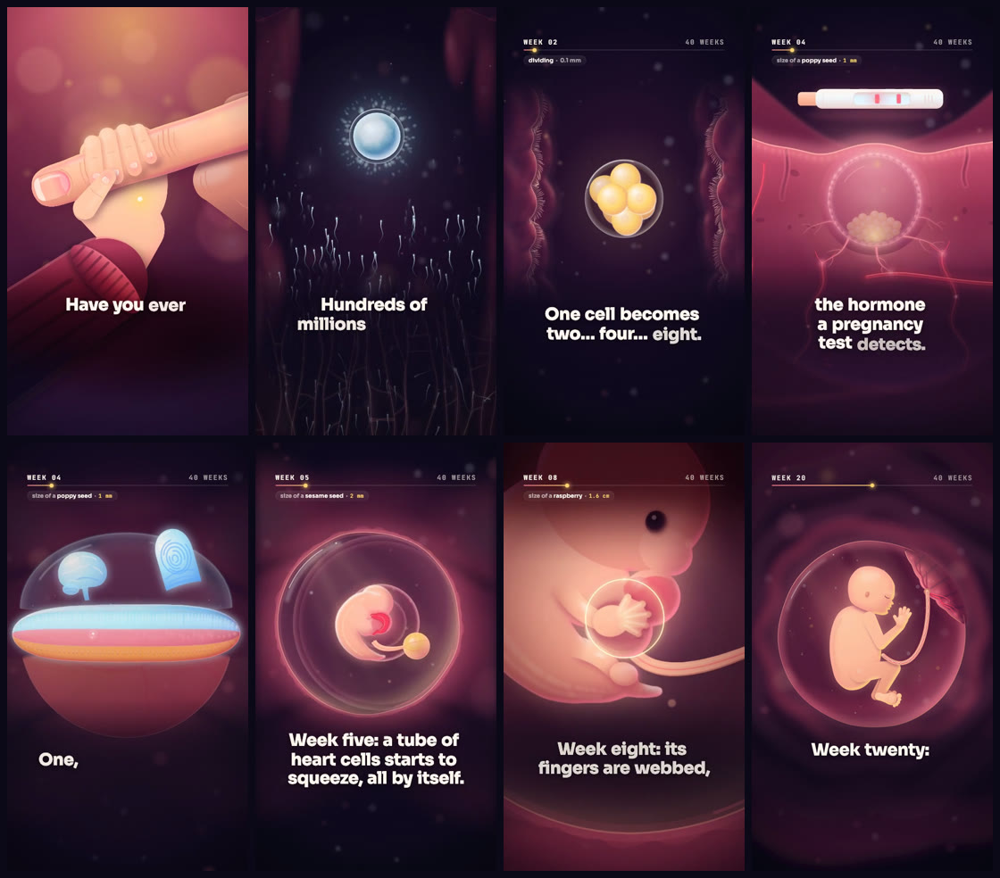
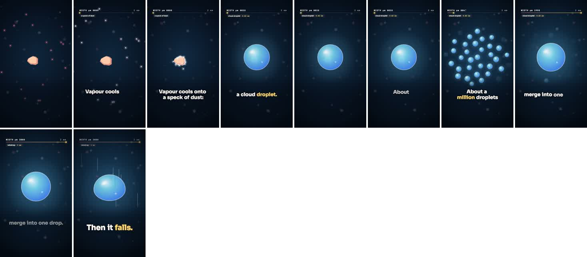

# motion-explainer

A [Claude Code](https://claude.com/claude-code) skill that makes motion-graphics explainer videos entirely in code (narrated, music-led or text-only, in any form: a process, a timeline, a comparison, a list, a data story, a map...). It uses [Remotion](https://www.remotion.dev) (React + TypeScript), and a video can be about anything: science, history, how something works, a product. You give it a topic. Claude then:
- researches the topic and fact-checks it;
- writes and judges a script;
- locks the timing first (usually a voice-over you generate);
- builds the film chapter by chapter, with independent agents that build and then polish each chapter;
- adds word-synced captions, sound effects and music;
- masters the audio, runs QA and renders a finished MP4.

The pipeline and its rules come from a real 2.5-minute, 17-chapter film made this way. Every mistake made on that film is written down, so the next film doesn't repeat it.

## What you get
- **`SKILL.md`**: the brief questions, the pipeline in order, the 20 rules that matter most, how to resume a project and show progress, the output-folder convention and the rules that keep a laptop responsive while rendering.
- **`references/`**: detailed guides that Claude reads as each step comes up:
  - `forms.md`: the forms an explainer can take (process, timeline, comparison, list, data story, map, walkthrough, kinetic type...), with what one chapter is, the overlays and kits each needs, style families, aspect ratios and which rules depend on the form;
  - `pipeline.md`: every step, with commands, a sizing table and what to re-run after a change;
  - `rules.md` and `lessons.md`: every rule with its evidence, and the full catalogue of mistakes;
  - `audio.md`: voice, splitting and alignment, SFX, music, loudness;
  - `orchestration.md`: prompt templates for builders, reviewers, QA lenses and skeptic verifiers;
  - `remotion-patterns.md`: transitions, handoffs, captions, safe zones, kits;
  - `accuracy.md`: the fact-check workflow, conventions, data honesty and tone.
- **`assets/template/`**: a starter project, with three parts:
  - a data-driven film: chapters, transitions, word-by-word captions, an optional counter, and isolated per-chapter previews;
  - scripts for previews, frames, renders and rough cuts, one-page chapter packs for agents, the voice split and alignment, a tools check, and QA probes (caption contrast, handoff diff, luma steps, sync drift, re-time guard, clicks, phone mix);
  - safe zones for a 9:16 frame (TikTok, Reels, Shorts) by default, and 16:9 and 1:1 by one setting.

## Install
```bash
git clone https://github.com/Marwanenoudouar10/motion-explainer ~/.claude/skills/motion-explainer
```
Claude Code picks up the skill automatically. Each new film is created in its own project folder, copied from the template, never inside the skill.

## Quick start
Open Claude Code anywhere and ask:

> make a 60-second vertical explainer about how volcanoes work

Claude asks a few questions (form, length, aspect, tone, voice source), then works through the pipeline. For a narrated film you do one step by hand: you generate the voice-over (a music-led film needs the track instead). Claude gives you a page of copy-paste prompt cards for ElevenLabs or another text-to-speech tool, and you drop the files in the project's `inbox/` folder. No voice yet, or you want a silent captioned video? Say so: Claude builds on planned timing, and the real take can be synced in later.

Other things to try:
- "turn this article into a 2-minute animated explainer for YouTube Shorts"
- "a motion-graphics video showing how our app syncs data offline, 45 seconds, 9:16"
- "a Kurzgesagt-style short about why the sky is blue"
- "a 90-second 16:9 history of the printing press for YouTube"
- "a 30-second animated chart of global CO2 emissions since 1900"
- "a top-5 countdown of the deepest places on Earth"
- "a whiteboard-style explainer of how a mortgage works"
- "a 1:1 kinetic-typography video of our company values, music only"

## Example output
**[One Cell to Birth](https://github.com/Marwanenoudouar10/one-cell-to-birth)** is a 2.5-minute vertical film about human development, from a single cell to birth, made with this pipeline.

<p align="center">
  
</p>

And a 10-second test made from scratch with the skill on a different topic, "How a raindrop forms" (dust speck, cloud droplet, a million droplets merging, the drop falling):

<p align="center">
  
</p>

## What you need
- **Node.js 18 or newer** (with npm). `nvm` works well.
- **ffmpeg** (a full build: Homebrew's works) and **Python 3.9+** (standard library only), for the audio pipeline, contact sheets and QA probes.
- **whisper.cpp** for word-level voice timing in narrated films: `brew install whisper-cpp`, plus its model:
  `mkdir -p ~/.cache/whisper && curl -L -o ~/.cache/whisper/ggml-base.en.bin https://huggingface.co/ggerganov/whisper.cpp/resolve/main/ggml-base.en.bin`
  (`ggml-base.bin` for narration in another language).
- Each project's `scripts/doctor.sh` checks all of these and prints the install line for anything missing.
- **A text-to-speech account**: [ElevenLabs](https://elevenlabs.io) through the website (no API key needed), Gemini TTS in Google AI Studio, or any other. Your own recorded voice works too.
- **A reasonably modern machine.** Renders run under `nice` at low scale, one at a time, so the computer stays usable. A full-resolution final render of a 2-minute film takes a while.

Remotion has its own [license](https://www.remotion.dev/license): it is free for individuals and small teams, and larger companies need a company license.

## License
[MIT](LICENSE) © 2026 Marwane Boudouar
